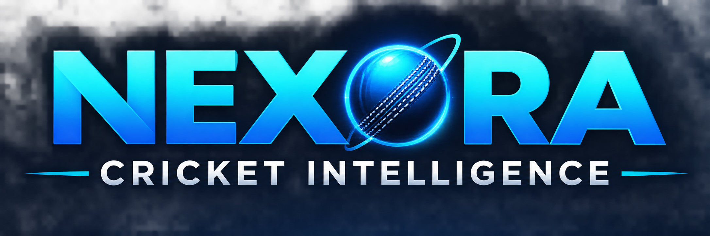

# 🏏 NEXORA Cricket Intelligence
### Interactive IPL Analytics Platform | Microsoft Power BI

<p align="center">
  
</p>

<p align="center">
  **WHERE CRICKET MEETS DATA INTELLIGENCE**
</p>

<p align="center">
  An interactive sports analytics platform exploring 17 IPL seasons (2008–2024) through player performance, team statistics, match insights, and tournament trends.
</p>

<p align="center">
  
  
  
  
</p>

---

## 📑 Table of Contents

1. [Project Overview](#-project-overview)
2. [Project Objectives](#-project-objectives)
3. [Dashboard Showcase](#-dashboard-showcase)
4. [Dashboard Modules](#-dashboard-modules)
5. [Key Performance Indicators](#-key-performance-indicators)
6. [Interactive Features](#-interactive-features)
7. [Tools and Technologies](#-tools-and-technologies)
8. [Dataset Information](#-dataset-information)
9. [Data Preparation and Modeling](#-data-preparation-and-modeling)
10. [How to Run the Project](#-how-to-run-the-project)
11. [Project Outcomes](#-project-outcomes)
12. [Repository Structure](#-repository-structure)
13. [Author](#-author)

---

## 🎯 Project Overview

**NEXORA Cricket Intelligence** is a multi-page IPL analytics platform developed using Microsoft Power BI to transform historical Indian Premier League data into meaningful cricket insights.

Covering **17 IPL seasons from 2008 to 2024**, the project analyzes match-level and ball-by-ball data to explore batting performance, bowling effectiveness, team achievements, match outcomes, and tournament trends.

The platform combines data transformation, analytical data modeling, DAX calculations, and interactive visualizations in a unified dashboard experience.

Its premium dark interface, cyan and purple accents, custom banners, and interactive navigation create a professional sports intelligence environment.

## 🎯 Project Objectives

- Analyze IPL tournament statistics across 17 seasons.
- Identify top-performing batsmen and bowlers.
- Evaluate batting and bowling performance using statistical measures.
- Compare franchise wins and overall team performance.
- Understand batting-first versus chasing match outcomes.
- Analyze toss decisions and their relationship with match results.
- Explore venue activity and season-wise scoring trends.
- Present complex cricket data through interactive visual storytelling.

---

# 📊 Dashboard Showcase

The project consists of six report pages: one introduction page and five analytical dashboard pages.

## 1. Introduction – NEXORA Cricket Intelligence

<p align="center">
  
</p>

**Purpose:** Introduces the analytics platform and provides navigation to its five analytical modules.

**Highlights:**
- NEXORA Cricket Intelligence branding.
- IPL 2008–2024 coverage.
- Overview of the five dashboard modules.
- Dedicated dashboard navigation experience.

## 2. Tournament Overview

<p align="center">
  
</p>

**Purpose:** Provides a consolidated overview of IPL tournament statistics and franchise achievements.

**Key insights and visualizations:**
- Total matches, teams, runs, and wickets.
- Orange Cap and Purple Cap leaders.
- Player of the Tournament.
- Runs by season and franchise.
- Batting-first versus chasing wins.
- Average runs per match by season.
- Franchise-wise wins and tournament titles.
- Season-wise highest and lowest innings.

## 3. Batting Intelligence

<p align="center">
  
</p>

**Purpose:** Evaluates individual batting performance and identifies the most productive batsmen.

**Key insights and visualizations:**
- Batter runs, total fours, and total sixes.
- Batting strike rate.
- Top 10 batters by runs.
- Top 10 batters by strike rate.
- Boundary comparison: fours versus sixes.
- Runs versus strike rate scatter analysis.

## 4. Bowling Intelligence

<p align="center">
  
</p>

**Purpose:** Analyzes bowling effectiveness, wicket-taking ability, and bowling performance.

**Key insights and visualizations:**
- Total wickets.
- Bowler runs conceded.
- Bowling economy.
- Legal balls bowled.
- Top wicket takers.
- Best bowling economy.
- Wickets by season.
- Bowling performance: runs versus wickets.
- Wickets by match phase.
- Dismissal type analysis.
- Over-by-over bowling analysis.

## 5. Match Insights

<p align="center">
  
</p>

**Purpose:** Explores match outcomes, toss decisions, venue activity, and winning patterns.

**Key insights and visualizations:**
- Total matches.
- Batting-first wins and chasing wins.
- Toss-to-wins percentage.
- Batting-first versus chasing comparison.
- Toss decision and match outcome analysis.
- IPL match locations and venue activity.
- Top 10 venues by matches hosted.
- Impact of winning the toss on match victory.

## 6. Team Performance

<p align="center">
  
</p>

**Purpose:** Compares IPL franchise performance through wins, winning percentages, and historical team rankings.

**Key insights and visualizations:**
- Total matches, wins, runs, and bowler wickets.
- Average runs per match.
- Wins by franchise.
- Win percentage by team.
- Team wins versus losses.
- Team rankings across IPL seasons.

---

## 🔢 Key Performance Indicators

The following values are displayed in the dashboard:

| Dashboard | KPI | Displayed Value |
|---|---|---:|
| Tournament Overview | Total Matches | 1,095 |
| Tournament Overview | Total Teams | 15 |
| Tournament Overview | Total Runs | 348K |
| Tournament Overview | Total Wickets | 13K |
| Batting Intelligence | Batter Runs | 330K |
| Batting Intelligence | Total Fours | 30K |
| Batting Intelligence | Total Sixes | 13K |
| Batting Intelligence | Batting Strike Rate | 130.70 |
| Bowling Intelligence | Total Wickets | 13K |
| Bowling Intelligence | Bowler Runs Conceded | 341K |
| Bowling Intelligence | Bowling Economy | 8.14 |
| Bowling Intelligence | Legal Balls Bowled | 251K |
| Match Insights | Batting First Wins | 500 |
| Match Insights | Chasing Wins | 590 |
| Match Insights | Toss-to-Wins % | 50.8% |
| Team Performance | Total Wins | 1,090 |
| Team Performance | Average Runs per Match | 158.79 |

*Values are reproduced from the displayed dashboard pages. Different pages use different measures and filter contexts.*

---

## ⚡ Interactive Features

The platform includes interactive features to support deeper exploration:

- **Season Filters:** Analyze individual IPL seasons or compare all seasons.
- **Team Filters:** Explore franchise-level performance.
- **Batter and Bowler Filters:** Focus on individual player statistics.
- **Venue Filters:** Examine match activity across venues.
- **Result Filters:** Explore team performance by match result.
- **Cross-Page Navigation:** Move between dashboard modules.
- **Reset Button:** Restore the report to its default filter state.
- **Interactive Visuals:** Explore detailed insights through Power BI visual interactions.

---

## 🛠️ Tools and Technologies

| Technology | Purpose |
|---|---|
| Microsoft Power BI | Dashboard development and visualization |
| DAX | Measures, calculations, and KPIs |
| Power Query | Data cleaning and transformation |
| Data Modeling | Relationships between match and delivery data |
| CSV | IPL source datasets |
| JSON | Custom Power BI report theme |

### Technical Implementation

- Developed a multi-page Power BI analytics solution.
- Created DAX measures for batting, bowling, and team statistics.
- Established relationships between match-level and ball-by-ball datasets.
- Standardized historical franchise names.
- Built season, team, and player-based analytical filters.
- Designed a consistent dark navy, cyan, and purple visual theme.
- Used different visual types to communicate different analytical perspectives.

---

## 📂 Dataset Information

The project uses two primary datasets covering IPL matches and ball-by-ball deliveries.

### 1. Matches Dataset – `matches.csv`

Contains match-level information such as:

- Match ID
- Season
- Date
- Teams
- Venue and city
- Toss winner
- Toss decision
- Match winner
- Player of the match
- Result details

### 2. Deliveries Dataset – `deliveries.csv`

Contains ball-by-ball information such as:

- Match ID
- Inning
- Batting team
- Bowling team
- Over and ball
- Batter
- Bowler
- Batsman runs
- Extra runs
- Total runs
- Wicket information
- Dismissal type

**Coverage:** IPL seasons 2008–2024.

---

## 🧹 Data Preparation and Modeling

Data preparation was performed using Power Query and Power BI modeling capabilities.

Key activities included:

- Standardizing historical franchise names.
- Handling missing and blank values.
- Correcting column data types.
- Validating match and delivery records.
- Preparing season and team dimensions.
- Establishing relationships between datasets.
- Developing measures for batting, bowling, and team analysis.

### Data Model

The analytical model uses match-level and delivery-level data, connected through their common match identifier.

---

## 🚀 How to Run the Project

Follow these steps to explore the dashboard locally.

**Step 1 – Clone the repository**

```bash
git clone https://github.com/Sujal2611/NEXORA-Cricket-Intelligence.git
```

**Step 2 – Open Power BI Desktop**

Navigate to the downloaded repository and open:

`Cricket_Analytics.pbix`

**Step 3 – Connect the datasets**

If Power BI requests updated file paths, reconnect the following files:

- `DataSet/matches.csv`
- `DataSet/deliveries.csv`

**Step 4 – Refresh the report**

Select **Home → Refresh** to load the data.

**Step 5 – Explore the dashboard**

Use the navigation buttons, filters, and interactive visualizations to explore IPL analytics.

---

## 💡 Project Outcomes

NEXORA Cricket Intelligence demonstrates the practical application of business intelligence techniques in sports analytics.

The project showcases:

- Transformation of raw cricket data into analytical information.
- Player performance evaluation using statistical measures.
- Franchise comparison and historical performance analysis.
- Match outcome and toss decision analysis.
- Interactive reporting using DAX and Power BI.
- Professional dashboard design and data storytelling.

---

## 📁 Repository Structure

```text
NEXORA-Cricket-Intelligence/
│
├── DataSet/
│   ├── deliveries.csv
│   └── matches.csv
│
├── Screenshots/
│   ├── 01-Introduction.png
│   ├── 02-Tournament-Overview.png
│   ├── 03-Batting-Intelligence.png
│   ├── 04-Bowling-Intelligence.png
│   ├── 05-Match-Insights.png
│   └── 06-Team-Performance.png
│
├── Cricket_Analytics.pbix
├── Cricket_Analytics.pdf
├── NEXORA_Theme.json
├── Logo.png
├── Intro_page.png
├── Match_Insights.png
├── IPL Batting Intelligence Banner.png
├── NEXORA Bowling Intelligence Banner.png
├── Nexora_Team_Performance_Banner_1280x150.png
├── Action Button.png
├── Title BG.png
└── README.md
```

---

## 👨‍💻 Author

### Sujal Upadhyay

Data Science Student | Aspiring Data Analyst

Interested in Data Analytics, Business Intelligence, SQL, and Data Visualization.

- **GitHub:** [Sujal2611](https://github.com/Sujal2611)
- **Project:** [NEXORA Cricket Intelligence](https://github.com/Sujal2611/NEXORA-Cricket-Intelligence)

---

## 🏁 Conclusion

NEXORA Cricket Intelligence brings cricket and data analytics together through an interactive, multi-page Power BI platform.

By combining data preparation, DAX, data modeling, and professional visualization, the project transforms historical IPL data into meaningful insights about players, teams, matches, and tournament performance.

<p align="center">
  **NEXORA – WHERE CRICKET MEETS DATA INTELLIGENCE. 🏏**
</p>

<p align="center">
  ⭐ If you find this project interesting, consider giving the repository a star!
</p>
